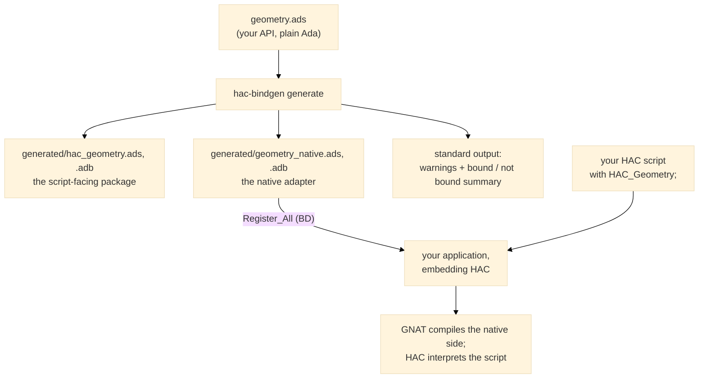

# hac_bindgen <!-- omit from toc -->

Embed the [HAC](https://github.com/zertovitch/hac) Ada interpreter in
your Ada application: users write scripts that run inside the program
and call its functions. Exposing those functions to a script takes
boilerplate — native callbacks, value conversions, registration, and
mirrored declarations. hac-bindgen generates all of it from your
package specification.

**An Ada-to-HAC binding generator: expose a native Ada API to embedded
HAC scripts without writing the interfacing glue by hand.**

`hac-bindgen` traverses ordinary Ada package specifications and generates
everything an embedded [HAC](https://github.com/zertovitch/hac) program
needs to call native code:

- the native adapter (argument retrieval, conversion, call, result
  conversion, callback registration), built on `HAC_Sys.Interfacing`;
- the HAC-side declarations (`with Import => True` stubs);
- the binding manifest.

Everything the API exposes and that hac-bindgen can bind is bound.
Everything it cannot bind is reported as a warning — never silently
dropped, and never a reason to reject the whole package.

## User guide

### Getting it done

For a package specification `geometry.ads`, one command generates the
facade:

```sh
hac-bindgen generate geometry.ads --output-dir generated --hac-package HAC_Geometry
```

What hac-bindgen writes, and what everyone does with it:



| Step | Who | What |
|---|---|---|
| 1. Generate | you | `hac-bindgen generate SOURCE... [--output-dir DIR] [--hac-package NAME]` |
| 2. Compile | GNAT | the generated `*_native.ads/.adb` (and the API body) join your GNAT project; call `<Pkg>_Native.Register_All (BD)` from your embedding main — see the complete example in [tests/e2e/witness_main.adb](tests/e2e/witness_main.adb) |
| 3. Run | HAC | your script `with`s the HAC-side package and calls the bound operations like any Ada package |

The generated file set, for a package `Geometry`:

| File | Side | Content |
|---|---|---|
| `geometry.ads` / `.adb` (or `hac_geometry.ads` / `.adb` with `--hac-package`) | HAC | the package the script `with`es: bound declarations, type mirrors, private imports |
| `geometry_native.ads` / `.adb` | native | `Register_All (BD)`, one callback per bound operation, the conversions, the handle registries |

`--hac-package` renames the HAC-side package so the generated files
can live in your source tree without clashing with the real
`geometry.ads` in GNAT's path. `hac-bindgen check SOURCE...` runs the
analysis and the classification only — same warnings, same summary,
no files written.

### What hac-bindgen does to your API

The analysis pipeline is: **analyze** (Libadalang backend, isolated in
its own crate) → **classify** (bindable or not) → **generate**. One
traversal feeds both `check` and `generate` ([S006]).

Bound today (the scalar and handle profiles):

- Procedures and functions with `in` parameters; a bound function is
  a real HAC function for the script.
- Scalars: `Integer`, `Long_Float`, `Boolean`, user-defined range
  types and their subtypes (native range checks preserved), and
  enumerations — mirrored exactly on the HAC side and converted by
  position, so representation clauses are harmless.
- Private and tagged private types: bound as **integer handles** —
  the script holds an opaque number, the generated adapter resolves
  it to the object it owns. A generated `Drop_<T>` operation releases
  the registry entry; a dropped or never-issued handle stops the
  script with a defined boundary error.

Warned out, never silently dropped ([B001]): each non-bindable
declaration gets a stable `HACBxxxx` identifier, the source location,
and a reason, on standard output, followed by a per-package bound /
not bound summary. Warnings are diagnostics: the exit status stays
`0`. The catalogue covers, among others: overloaded names, access
types and `System.Address`, records as boundary values, `out` /
`in out` parameters, generics, tasks and protected objects,
exception declarations.

Not yet (planned, [docs/roadmap.md](docs/roadmap.md)): `out` /
`in out` copy-back, strings end to end, several bound packages in one
run, repeated script execution.

The conversion rule everywhere: **no silent conversion** ([S003]) —
a value that cannot cross safely is warned out at generation time or
reports a defined error at run time, never a default value.

## Status

Development. See [docs/manifesto.md](docs/manifesto.md) for the
motivation and the principles, and
[docs/specifications.md](docs/specifications.md) for the specification
structure and the index of features.

## Build and test

```sh
make build   # Alire build
make check   # build + bbt executable documentation
make a003    # shortcut to run A003_interchange_dump.md scenario
```

## Licence

Apache-2.0, like HAC.
