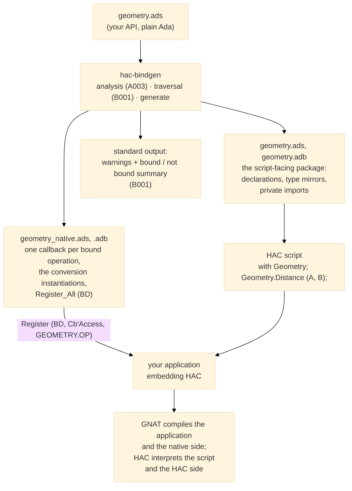

# A002 — Facade generation: the scalar profile <!-- omit from toc -->

The core feature: hac-bindgen generates the scripting facade from the
supplied API ([S006], [S009]). This page covers the first profile:
one package, procedures and functions with `in` parameters, and the
scalar types HAC supports natively. Wider traits (handles,
enumerations, strings) get their own `Annn` page when their mapping is
demonstrated end to end.

Out of scope, by design: `out` / `in out` parameters and copy-back
(M6, [A002-06]), strings and `VString` boundaries (M6), handles (M6),
several bound packages in one run (M6), the binding manifest and the
`--native-package` and `--manifest` options (gadgets). The generated
callbacks let every exception propagate to HAC's error mechanism
([S007]); the runtime behavior is [C002](C002_boundary_errors.md)'s
subject.

Guarantees: `generate` prints the same warnings and summary as
`check` ([B001]) and writes the generated files for the bound part
only; the generated native code compiles with GNAT, the generated HAC
declarations compile with the real HAC compiler ([S012]); two runs on
the same input produce byte-identical files ([S001]) and every
generated file carries the generator version ([S002]); scalar
parameters and results survive round trips with the conversions
documented in the M2 evidence.

## Contents <!-- omit from toc -->

- [Generated file set](#generated-file-set)
- [Callback layout](#callback-layout)
- [HAC-side declarations](#hac-side-declarations)
- [Command behavior](#command-behavior)
- [End-to-end test harness](#end-to-end-test-harness)
- [Executable scenarios](#executable-scenarios)
  - [Scenario: a script calls a bound procedure end to end](#scenario-a-script-calls-a-bound-procedure-end-to-end)
  - [Scenario: scalar round trips](#scenario-scalar-round-trips)
  - [Scenario: user-defined scalars round trips](#scenario-user-defined-scalars-round-trips)
  - [Scenario: a bound function is a real HAC function](#scenario-a-bound-function-is-a-real-hac-function)
  - [Scenario: the generated files cover the bound part only](#scenario-the-generated-files-cover-the-bound-part-only)
  - [Scenario: two runs produce byte-identical files](#scenario-two-runs-produce-byte-identical-files)
  - [Scenario: every generated file carries the version header](#scenario-every-generated-file-carries-the-version-header)
- [Verification beyond bbt](#verification-beyond-bbt)
- [Design implications](#design-implications)

## Generated file set

The whole picture — what exists before, what hac-bindgen generates,
and who compiles or interprets what:



For a package `Geometry` (source `geometry.ads`), `generate` writes,
in the output directory (default: the current directory):

| File | Side | Content |
|---|---|---|
| `geometry.ads` | HAC | The package the script `with`es: the bound subprogram declarations (functions as functions), the mirrored bindable types, and — in the private part — one imported procedure per bound operation |
| `geometry.adb` | HAC | The package body: empty when the API has no function, otherwise the wrapper bodies calling the imported procedures — HAC requires a body as soon as the spec declares subprograms, imported or not |
| `geometry_native.ads` | native | The `Register_All (BD : HAC_Sys.Builder.Build_Data)` entry point |
| `geometry_native.adb` | native | One callback per bound operation, the conversion instantiations it needs, and `Register_All` |

The HAC-side package keeps the API name: the script calls
`Geometry.Distance (A, B)` as if it were the original package. The
native adapter is a sibling named `<Pkg>_Native`, like the manual
witness (`Witness_API` / `Witness_Native` in `tests/witness/`). The
HAC-side files are never compiled by GNAT — they are interpreted from
source by HAC at run time — so the name collision with the real
`geometry.ads` is only a source-tree layout matter, resolved by
`--output-dir`.

The HAC-side names are not a choice: HAC resolves a unit through the
GNAT file naming convention — `<unit>.ads` / `<unit>.adb`, hardcoded
in `hac_sys-librarian.adb` (HAC 0.45.0) — so a HAC-side package
`Geometry` can only live in `geometry.ads` / `geometry.adb`, and
HAC's own examples follow the same pattern (`exm/`,
`demo/data_exchange`).

Every generated file starts with a fixed header naming the generator
and its version ([S002]): `--  Generated by hac-bindgen <version> — do
not edit.`

## Callback layout

Per the M2 evidence (`docs/dev/hac_interfacing_notes.md`):

- `Data` is 1-based; parameters occupy `Data` slots in declaration
  order, one slot per scalar.
- A bound procedure `P (A, B)` reads its arguments from
  `Data (1 .. 2)`; a bound function `F (A) return R` writes its result
  into `Data (1)` and reads its arguments from `Data (2)`.
- The callback converts each argument to its native type, calls the
  real subprogram, and converts the result back. It never catches
  exceptions: a failure propagates to HAC and stops the script
  ([S007], classes 2 and 3; detailed behavior in C002).
- Conversions: direct `To_HAC` / `To_Native` overloads for `Integer`
  and `Long_Float`; instantiated `To_HAC_Any_Integer`,
  `To_Native_Any_Integer`, `To_HAC_Any_Enum`, `To_Native_Any_Enum`,
  `To_HAC_Any_Float`, `To_Native_Any_Float` for user-defined scalars —
  one instantiation per used type, generated in the native package
  body.
- Registration: `Register (BD, Callback'Access, "GEOMETRY.<OP>")` —
  the qualified name of the HAC-side declaration, uppercased;
  `Register_All` registers every bound operation of the package.

## HAC-side declarations

- Each bound procedure is declared as a procedure with
  `with Import => True`, in the package private part, under the
  registration name.
- Each bound function is declared twice: an imported procedure
  `<Op>_Callback (Result : out R; ...)` in the private part, and a
  public function `<Op>` whose body (in the generated package body)
  calls the imported procedure through a local result variable — the
  witness pattern (`Sum_Callback` wrapped by the HAC function `Sum`),
  generated instead of handwritten.
- Bindable types used by bound profiles are mirrored on the HAC side,
  exactly as declared: the generated HAC-side declaration repeats the
  source declaration (`type Shade is (Red, Green, Blue);`,
  `type Small is new Integer range 1 .. 10;`,
  `subtype Sub_Int is Small range 1 .. 5;`). This is possible because
  the model now carries the mirror text of each type declaration, the
  way it carries type categories; a declaration with a dynamic
  constraint cannot be mirrored exactly and is warned out
  (`HACB0013`) instead of being mirrored lossy. A type used by no
  bound profile is not mirrored.
- Conversion instantiations are generated per source type mark, not
  per root type: a parameter of a subtype converts through its own
  subtype, so the native range check applies exactly as in the M2
  witness (`witness_range_error`).
- The HAC-side package name defaults to the API name; the
  `--hac-package NAME` option renames it (the generated HAC-side
  files then follow that name's GNAT file naming, e.g.
  `hac_calc_api.ads`), which lets the generated HAC-side files live in
  the same directory tree as the real API without a duplicate unit in
  GNAT's source path. The registration names follow the HAC-side
  package name (`HAC_CALC_API.PING`).
- The private part holds only what the public declarations need;
  nothing of the non-bindable API leaks into the generated files
  ([S006], [S009]).

## Command behavior

`generate` runs the same analysis and traversal as `check` ([S006]):
same warnings, same summary, same exit status rules — `0` with
warnings, `1` on analysis failure ([C001]), no generated file is
written or left behind when the analysis fails. Files are written only
after the whole classification succeeds.

## End-to-end test harness

The end-to-end scenarios compile and run the real chain ([S008]). The
harness bridges the static world of the compiled witness and the
per-scenario generated names with a one-line package renaming:

- `tests/e2e/witness_main.adb` is static and never changes: it
  prepares the HAC environment, calls
  `Witness_Binding.Register_All`, compiles and runs the script given
  as argument, and reports completion. It `with`s only
  `Witness_Binding`.
- Each end-to-end scenario writes, in its fresh directory: the API
  fixture under its own name (the naming is exercised with arbitrary
  package names), runs `generate`, writes the two-line
  `witness_binding.ads`
  (`with <Pkg>_Native;` / `package Witness_Binding renames
  <Pkg>_Native;`), and the HAC script.
- The scenario then builds with
  `alr exec -- gprbuild -P ../../tests/e2e/witness.gpr
  -XSCENARIO_DIR=$PWD` — the project takes the scenario directory as
  an external (`external ("SCENARIO_DIR")`), keeps the object files
  inside it, and the scenario creates the object directory before
  building. `--cleanup=full` makes every run hermetic.

The witness never changes when the fixture API grows: adding one
operation is proven with zero handwritten glue ([S009]), by
construction.

## Executable scenarios

Generation-only scenarios compare the produced files; end-to-end
scenarios compile and run the real chain ([S008]), through the harness
of the specification above: the scenario files land in `run/`, the
witness is built there and runs the scenario's script. All scenarios
run from `tests/`.

| Scenario | Behavior |
|---|---|
| A002-01 | a script calls a bound procedure end to end through a witness application |
| A002-02 | scalar round trips: integer, float, boolean survive the boundary |
| A002-03 | user-defined scalars: range type, enumeration, subtype round trips |
| A002-04 | a bound function is a real HAC function for the script |
| A002-05 | the generated files cover the bound part only |
| A002-07 | two runs produce byte-identical files |
| A002-08 | every generated file carries the version header |

A002-06 (copy-back), strings, handles and multi-package scenarios are
M6 work and get their own scenarios then.

### Scenario: a script calls a bound procedure end to end

- Given the new directory `run`
- Given the new file `run/ping_api.ads` containing
  ```ada
  package Ping_Api is
     procedure Ping (X : in Integer);
  end Ping_Api;
  ```
- Given the new file `run/ping_api.adb` containing
  ```ada
  with Ada.Text_IO;
  package body Ping_Api is
     procedure Ping (X : in Integer) is
     begin
        Ada.Text_IO.Put_Line ("native: Ping" & Integer'Image (X));
     end Ping;
  end Ping_Api;
  ```
- When I successfully run `../bin/hac-bindgen generate run/ping_api.ads --output-dir run --hac-package HAC_Ping_Api`
- Given the new file `run/witness_binding.ads` containing
  ```ada
  with Ping_Api_Native;
  package Witness_Binding renames Ping_Api_Native;
  ```
- Given the new file `run/ping_script.adb` containing
  ```ada
  with HAC_Ping_Api;
  procedure Ping_Script is
  begin
     HAC_Ping_Api.Ping (42);
  end Ping_Script;
  ```
- When I successfully run shell `alr exec -- gprbuild -q -P e2e/witness.gpr`
- When I successfully run `./run/witness_main run/ping_script.adb`
- Then I get
  ```text
  native: Ping 42
  E2E: script completed.
  ```

### Scenario: scalar round trips

- Given the new directory `run`
- Given the new file `run/scalar_api.ads` containing
  ```ada
  package Scalar_Api is
     procedure Check
       (I : in Integer;
        R : in Long_Float;
        B : in Boolean);
  end Scalar_Api;
  ```
- Given the new file `run/scalar_api.adb` containing
  ```ada
  with Ada.Text_IO;
  package body Scalar_Api is
     procedure Check
       (I : in Integer;
        R : in Long_Float;
        B : in Boolean)
     is
     begin
       if I = 42 and then R = 1.5 and then B then
          Ada.Text_IO.Put_Line ("native: values survived");
       else
          Ada.Text_IO.Put_Line ("native: MISMATCH");
       end if;
     end Check;
  end Scalar_Api;
  ```
- When I successfully run `../bin/hac-bindgen generate run/scalar_api.ads --output-dir run --hac-package HAC_Scalar_Api`
- Given the new file `run/witness_binding.ads` containing
  ```ada
  with Scalar_Api_Native;
  package Witness_Binding renames Scalar_Api_Native;
  ```
- Given the new file `run/scalar_script.adb` containing
  ```ada
  with HAC_Scalar_Api;
  procedure Scalar_Script is
  begin
     HAC_Scalar_Api.Check (42, 1.5, True);
  end Scalar_Script;
  ```
- When I successfully run shell `alr exec -- gprbuild -q -P e2e/witness.gpr`
- When I successfully run `./run/witness_main run/scalar_script.adb`
- Then I get
  ```text
  native: values survived
  E2E: script completed.
  ```

### Scenario: user-defined scalars round trips

- Given the new directory `run`
- Given the new file `run/shade_api.ads` containing
  ```ada
  package Shade_Api is
     type Shade is (Red, Green, Blue);
     type Small is range -100 .. 100;
     subtype Narrow is Small range -10 .. 10;
     procedure Check
       (C : in Shade;
        S : in Small;
        N : in Narrow);
  end Shade_Api;
  ```
- Given the new file `run/shade_api.adb` containing
  ```ada
  with Ada.Text_IO;
  package body Shade_Api is
     procedure Check
       (C : in Shade;
        S : in Small;
        N : in Narrow)
     is
     begin
        if C = Green and then S = 42 and then N = -7 then
           Ada.Text_IO.Put_Line ("native: values survived");
        else
           Ada.Text_IO.Put_Line ("native: MISMATCH");
        end if;
     end Check;
  end Shade_Api;
  ```
- When I successfully run `../bin/hac-bindgen generate run/shade_api.ads --output-dir run --hac-package HAC_Shade_Api`
- Given the new file `run/witness_binding.ads` containing
  ```ada
  with Shade_Api_Native;
  package Witness_Binding renames Shade_Api_Native;
  ```
- Given the new file `run/shade_script.adb` containing
  ```ada
  with HAC_Shade_Api;
  procedure Shade_Script is
  begin
     HAC_Shade_Api.Check (HAC_Shade_Api.Green, 42, -7);
  end Shade_Script;
  ```
- When I successfully run shell `alr exec -- gprbuild -q -P e2e/witness.gpr`
- When I successfully run `./run/witness_main run/shade_script.adb`
- Then I get
  ```text
  native: values survived
  E2E: script completed.
  ```

### Scenario: a bound function is a real HAC function

- Given the new directory `run`
- Given the new file `run/func_api.ads` containing
  ```ada
  package Func_Api is
     function Twice (X : in Integer) return Integer;
  end Func_Api;
  ```
- Given the new file `run/func_api.adb` containing
  ```ada
  package body Func_Api is
     function Twice (X : in Integer) return Integer is
     begin
        return 2 * X;
     end Twice;
  end Func_Api;
  ```
- When I successfully run `../bin/hac-bindgen generate run/func_api.ads --output-dir run --hac-package HAC_Func_Api`
- Given the new file `run/witness_binding.ads` containing
  ```ada
  with Func_Api_Native;
  package Witness_Binding renames Func_Api_Native;
  ```
- Given the new file `run/func_script.adb` containing
  ```ada
  with HAC_Func_Api;
  procedure Func_Script is
     V : Integer;
  begin
     V := HAC_Func_Api.Twice (21);
     V := V + 1;
  end Func_Script;
  ```
- When I successfully run shell `alr exec -- gprbuild -q -P e2e/witness.gpr`
- When I successfully run `./run/witness_main run/func_script.adb`
- Then I get
  ```text
  E2E: script completed.
  ```

### Scenario: the generated files cover the bound part only

- Given the new file `mixed_probe.ads` containing
  ```ada
  package Mixed_Probe is
     type Point is record
        X, Y : Integer;
     end record;
     procedure Ping (X : in Integer);
     procedure Move (P : in Point);
     function Get (X : in Integer) return Integer;
  end Mixed_Probe;
  ```
- When I run `../bin/hac-bindgen generate mixed_probe.ads --output-dir gen`
- Then there is no error
- And the output contains `warning HACB0005`
- And the output contains `2 operations bound, 1 not bound`
- And there is a file `gen/mixed_probe.ads`
- And the file `gen/mixed_probe.ads` contains
  ```
  procedure Ping (X : in Integer) with Import => True;
  ```
- And the file `gen/mixed_probe.ads` contains
  ```
  function Get (X : in Integer) return Integer;
  ```
- And the file `gen/mixed_probe.ads` does not contain `Move`
- And the file `gen/mixed_probe_native.adb` does not contain `Move`

### Scenario: two runs produce byte-identical files

- Given the new file `mixed_probe.ads` containing
  ```ada
  package Mixed_Probe is
     procedure Ping (X : in Integer);
  end Mixed_Probe;
  ```
- When I successfully run `../bin/hac-bindgen generate mixed_probe.ads --output-dir gen1`
- And I successfully run `../bin/hac-bindgen generate mixed_probe.ads --output-dir gen2`
- Then I successfully run shell `diff -r gen1 gen2`

### Scenario: every generated file carries the version header

- Given the new file `mixed_probe.ads` containing
  ```ada
  package Mixed_Probe is
     procedure Ping (X : in Integer);
     function Get (X : in Integer) return Integer;
  end Mixed_Probe;
  ```
- When I successfully run `../bin/hac-bindgen generate mixed_probe.ads --output-dir gen`
- Then the file `gen/mixed_probe.ads` contains `Generated by hac-bindgen`
- And the file `gen/mixed_probe_native.ads` contains `Generated by hac-bindgen`
- And the file `gen/mixed_probe_native.adb` contains `Generated by hac-bindgen`
- And there is a file `gen/mixed_probe.adb`

## Verification beyond bbt

- Unit tests: not applicable — the bbt scenarios are the test suite.
- SPARK / proof: not applicable.
- Other: the generated code is itself verified by the scenarios'
  real GNAT and HAC compilations; no golden file of generated source —
  the scenarios check the structural facts that matter (declarations
  present, imports, registration names) with focused steps, and the
  end-to-end output with the script's observable result.

## Design implications

The callback surface, conversion table, and error behavior come from
the M2 evidence in `docs/dev/hac_interfacing_notes.md` and are already
exercised by the manual witness; the generator reproduces that
verified shape. The single-traversal rule ([S006]) keeps `check` and
`generate` on the same classification path. Naming (HAC-side package
keeps the API name; native adapter as `<Pkg>_Native` sibling;
`<Op>_Callback` for the imported procedure of a function) is stated in
the specification above and frozen with the first green end-to-end
scenario.
