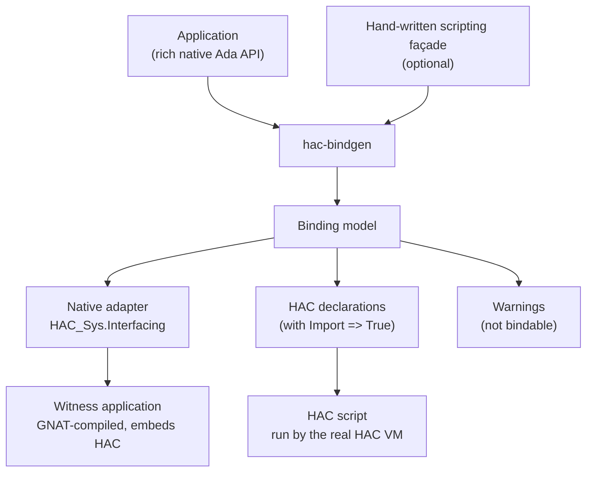

# hac_bindgen manifesto

The manifesto describe the project motivations. 
The detailed, testable content lives in [`specifications.md`](specifications.md)
and in the [`features/`](features/) pages.

## 1. Motivation

HAC can be embedded into an Ada application and supports data exchange
between a HAC program and its native host through dynamically registered
callbacks. This makes HAC a credible embedded scripting language for
Ada applications — but exposing native Ada operations to HAC requires
application-specific interfacing code: retrieving arguments from the
virtual machine, validating and converting them, invoking the native
subprogram, converting the result, registering the callback, providing
declarations usable by HAC programs, and translating errors.

That glue is mechanical, repetitive and error-prone as a scripting API
grows. `hac-bindgen` generates it.

## 2. The primary objective

**hac-bindgen generates the scripting façade from the rich native API.**

An application that wants to embed HAC does not have to write a
restricted, profile-compliant façade first. It points hac-bindgen at the
package specification(s) it wants to expose — typically its rich native
API, private types, overloads, tagged types and all — and hac-bindgen:

1. traverses the public API of the supplied package(s);
2. binds every public subprogram whose signature it can map to HAC,
   with explicit, tested conversion rules;
3. emits a warning for every public subprogram or type it cannot bind,
   with the reason and the source location;
4. generates the native adapter, the HAC-side declarations and the
   registration code for what was bound.

A hand-written scripting façade remains a perfectly valid input: if the
application wants or needs one — to curate the exposed surface, to
translate internal types into handles, to rename operations — it writes
it, and hac-bindgen binds it the same way. Seen from hac-bindgen, there
is no difference: there is an API to interface, and the traversal
decides, declaration by declaration, what is bound and what is warned.

Consequences:

- there is no *binding-profile rejection* of a package: an input
  package is never "invalid" as a whole;
- warnings replace rejections: the tool reports what it did and did not
  bind, and why, instead of refusing to work;
- export selection is decided by the traversal, declaration by declaration, not assumed about the input.

## 3. Principles

1. **Plain legal Ada is the only input.** No IDL, no JSON or YAML
   description, no invented aspects (`with HAC_Export`, ...) and no
   hac-bindgen-specific syntax. The application compiles its own
   sources with its own compiler, independently of hac-bindgen.

2. **Traversal, not validation gate.** The tool walks the API and
   classifies each public declaration: bindable, or not. A non-bindable
   declaration produces a warning carrying a stable identifier, the
   source location and the reason. Generation proceeds for the rest.

3. **No silent conversion.** A binding never narrows a numeric value,
   truncates a string, reinterprets an integer as an object, or
   suppresses an exception. When a conversion cannot be performed
   safely, the declaration is warned out at generation time, or the
   generated callback reports a defined boundary error at run time.

4. **Parsing is not binding.** An analyser may recognise far more
   constructs than hac-bindgen binds. A construct is accepted only when
   its conversion rules are explicit, its failure behaviour is defined,
   and the generated code is tested end to end.

5. **The application owns object semantics.** hac-bindgen transports
   scalars and opaque identifiers. It does not own application objects,
   does not infer ownership or lifetime, and does not prescribe an
   object model. Handles are the application's decision.

6. **Generated code is inspectable.** It is formatted as normal Ada,
   reproducible from the same input, free of timestamps and
   machine-specific data, clearly marked as generated, and compilable
   through the normal GNAT and HAC build processes.

7. **Real execution is the proof.** The primary correctness criterion
   is a real HAC program calling a real GNAT-compiled application
   through the generated bindings. Generated source that looks
   plausible is not evidence.

## 4. Test philosophy

The tests use [bbt](https://github.com/LionelDraghi/bbt) executable
scenarios:

- the **Given** are Ada files — the API to interface, with bodies that
  `Put_Line` their parameters, so that bbt can observe, from the
  printed output, that a call actually happened, in both directions;
- the **When**: the invocations - hac-bindgen generates the glue, then the real toolchain runs: GNAT builds the native side, the HAC compiler and VM execute the scripts;
- the **Then**: bbt compares the observed output with the expected one;

Tests are end to end: they never stop at "the generated code looks
right". A scenario runs the whole chain — façade, generated adapter,
witness application, HAC script — and bbt owns the expected output.

## 5. Architecture in one picture

## 6. Priorities

The development plan in [`roadmap.md`](roadmap.md) prioritises:

**Essential** (the product):

- rich-API traversal and binding-model construction;
- native adapter, HAC declarations and registration generation;
- the scalar profile first: procedures, functions, `in` parameters,
  integers, floats, Booleans, then handles and enumerations;
- warnings for everything not bound;
- end-to-end bbt tests through the real GNAT and HAC toolchains.

**Gadgets** (nice to have, later):

- JSON binding manifest, `verify` command, alternative diagnostic
  formats (gcc, SARIF);
- the second analysis backend and its comparison;
- CI, AppImage, Alire publication.

## 7. Final statement

> The application exposes an API — rich or curated, its choice.
> hac-bindgen binds what HAC can call, warns on what it cannot,
> and generates the glue.
> The application keeps its objects, its lifetime, its semantics.
> A real HAC script and a real GNAT-compiled application validate
> the result, end to end, under bbt.
