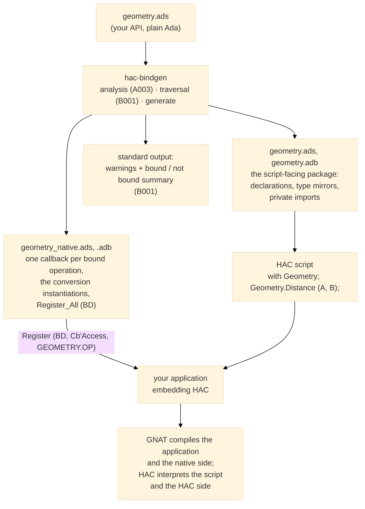

# A002 — Facade generation: the scalar profile <!-- omit from toc -->

Status: Proposed
Source: roadmap M4 (the product), [S006], [S008], [S009]

## Need

The analysis path is complete: `hac-bindgen check` builds the binding
model from the format-1 dump and classifies every declaration
([B001]). Nothing is generated yet: the user has no façade. This is
the core feature — the tool must turn the bound part of the model into
the scripting façade: native callbacks, HAC declarations, and
registration ([S006], [S009]).

## Intended outcome

`hac-bindgen generate SOURCE... [--output-dir DIR]` produces, for each
bound package of the scalar profile, the complete glue a HAC script
and a native application need — and nothing else. The generated code
compiles with GNAT, the generated HAC declarations compile with the
real HAC compiler, and a script calling the bound operations runs end
to end in a witness application ([S008]). Adding one bindable
operation requires no handwritten glue ([S009]).

## Scope

- The `generate` command of the scalar profile: procedures and
  functions with `in` parameters, scalar types (integers, floats,
  booleans, enumerations and their user-defined variants).
- The generated file set, the callback layout, the registration
  scheme, the HAC-side declarations, and the function wrapping.
- The witness application in `tests/` that the end-to-end scenarios
  drive; only its generic HAC embedding bootstrap is handwritten
  ([S009]).

## Non-goals

- `out` / `in out` parameters and copy-back (M6, [A002-06]).
- Strings and `VString` boundaries (M6).
- Handles and enumeration-rich profiles (M6, future `Annn` pages).
- Several bound packages in one run (M6).
- The binding manifest (gadget), the `--native-package`,
  `--hac-package` and `--manifest` options (A001 planned options).
- Runtime boundary errors: generated callbacks let every exception
  propagate to HAC's error mechanism ([S007]); their observable
  behavior is C002's subject.

## Acceptance criteria

- `generate` on a mixed package exits `0`, prints the same warnings
  and summary as `check` ([B001]), and writes the generated files for
  the bound part only.
- The generated native code compiles with GNAT; the generated HAC
  package compiles with the real HAC compiler ([S012]).
- A witness application embedding HAC registers the generated
  bindings and runs a script that calls the bound operations; the
  observed results match the script's expectations ([S008]).
- Scalar parameters and results survive round trips with the
  conversions documented in the M2 evidence.
- Two runs on the same input produce byte-identical files ([S001]),
  and every generated file carries the generator version ([S002]).

## Specification

### Generated file set

The whole picture — what exists before, what hac-bindgen generates,
and who compiles or interprets what:

For a package `Geometry` (source `geometry.ads`), `generate` writes,
in the output directory (default: the current directory):

| File | Side | Content |
|---|---|---|
| `geometry.ads` | HAC | The package the script `with`es: the bound subprogram declarations (functions as functions), the mirrored bindable types, and — in the private part — one imported procedure per bound operation |
| `geometry.adb` | HAC | Only when the API has functions: the wrapper bodies calling the imported procedures |
| `geometry_native.ads` | native | The `Register_All (BD : HAC_Sys.Builder.Build_Data)` entry point |
| `geometry_native.adb` | native | One callback per bound operation, the conversion instantiations it needs, and `Register_All` |

The HAC-side package keeps the API name: the script calls
`Geometry.Distance (A, B)` as if it were the original package. The
native adapter is a sibling named `<Pkg>_Native`, like the manual
witness (`Witness_API` / `Witness_Native` in `tests/witness/`). The
HAC-side files are never compiled by GNAT — they are interpreted from
source by HAC at run time — so the name collision with the real
`geometry.ads` is only a source-tree layout matter, resolved by
`--output-dir`.

The HAC-side names are not a choice: HAC resolves a unit through the
GNAT file naming convention — `<unit>.ads` / `<unit>.adb`, hardcoded
in `hac_sys-librarian.adb` (HAC 0.45.0) — so a HAC-side package
`Geometry` can only live in `geometry.ads` / `geometry.adb`, and
HAC's own examples follow the same pattern (`exm/`,
`demo/data_exchange`).

Every generated file starts with a fixed header naming the generator
and its version ([S002]): `--  Generated by hac-bindgen <version> — do
not edit.`

### Callback layout

Per the M2 evidence (`docs/dev/hac_interfacing_notes.md`):

- `Data` is 1-based; parameters occupy `Data` slots in declaration
  order, one slot per scalar.
- A bound procedure `P (A, B)` reads its arguments from
  `Data (1 .. 2)`; a bound function `F (A) return R` writes its result
  into `Data (1)` and reads its arguments from `Data (2)`.
- The callback converts each argument to its native type, calls the
  real subprogram, and converts the result back. It never catches
  exceptions: a failure propagates to HAC and stops the script
  ([S007], classes 2 and 3; detailed behavior in C002).
- Conversions: direct `To_HAC` / `To_Native` overloads for `Integer`
  and `Long_Float`; instantiated `To_HAC_Any_Integer`,
  `To_Native_Any_Integer`, `To_HAC_Any_Enum`, `To_Native_Any_Enum`,
  `To_HAC_Any_Float`, `To_Native_Any_Float` for user-defined scalars —
  one instantiation per used type, generated in the native package
  body.
- Registration: `Register (BD, Callback'Access, "GEOMETRY.<OP>")` —
  the qualified name of the HAC-side declaration, uppercased;
  `Register_All` registers every bound operation of the package.

### HAC-side declarations

- Each bound procedure is declared as a procedure with
  `with Import => True`, in the package private part, under the
  registration name.
- Each bound function is declared twice: an imported procedure
  `<Op>_Callback (Result : out R; ...)` in the private part, and a
  public function `<Op>` whose body (in the generated package body)
  calls the imported procedure through a local result variable — the
  witness pattern (`Sum_Callback` wrapped by the HAC function `Sum`),
  generated instead of handwritten.
- Bindable types used by bound profiles are mirrored on the HAC side:
  enumerations verbatim; integer and float derived types and subtypes
  with their range or digits constraint. A type used by no bound
  profile is not mirrored.
- The private part holds only what the public declarations need;
  nothing of the non-bindable API leaks into the generated files
  ([S006], [S009]).

### Command behavior

`generate` runs the same analysis and traversal as `check` ([S006]):
same warnings, same summary, same exit status rules — `0` with
warnings, `1` on analysis failure ([C001]), no generated file is
written or left behind when the analysis fails. Files are written only
after the whole classification succeeds.

### End-to-end test harness

The end-to-end scenarios compile and run the real chain ([S008]). The
harness bridges the static world of the compiled witness and the
per-scenario generated names with a one-line package renaming:

- `tests/e2e/witness_main.adb` is static and never changes: it
  prepares the HAC environment, calls
  `Witness_Binding.Register_All`, compiles and runs the script given
  as argument, and reports completion. It `with`s only
  `Witness_Binding`.
- Each end-to-end scenario writes, in its fresh directory: the API
  fixture under its own name (the naming is exercised with arbitrary
  package names), runs `generate`, writes the two-line
  `witness_binding.ads`
  (`with <Pkg>_Native;` / `package Witness_Binding renames
  <Pkg>_Native;`), and the HAC script.
- The scenario then builds with
  `alr exec -- gprbuild -P ../../tests/e2e/witness.gpr
  -XSCENARIO_DIR=$PWD` — the project takes the scenario directory as
  an external (`external ("SCENARIO_DIR")`), keeps the object files
  inside it, and the scenario creates the object directory before
  building. `--cleanup=full` makes every run hermetic.

The witness never changes when the fixture API grows: adding one
operation is proven with zero handwritten glue ([S009]), by
construction.

## Executable scenarios

Generation-only scenarios compare the produced files; end-to-end
scenarios compile and run the real chain ([S008]). All run from
`tests/`.

| Scenario | Behavior |
|---|---|
| A002-01 | a script calls a bound procedure end to end through a witness application |
| A002-02 | scalar round trips: integer, float, boolean survive the boundary |
| A002-03 | user-defined scalars: range type, enumeration, float subtype round trips |
| A002-04 | a bound function is a real HAC function for the script |
| A002-05 | the generated files cover the bound part only |
| A002-07 | two runs produce byte-identical files |
| A002-08 | every generated file carries the version header |

A002-06 (copy-back), strings, handles and multi-package scenarios are
M6 work and get their own scenarios then.

## Verification beyond bbt

- Unit tests: not applicable — the bbt scenarios are the test suite.
- SPARK / proof: not applicable.
- Other: the generated code is itself verified by the scenarios'
  real GNAT and HAC compilations; no golden file of generated source —
  the scenarios check the structural facts that matter (declarations
  present, imports, registration names) with focused steps, and the
  end-to-end output with the script's observable result.

## Design implications

The callback surface, conversion table, and error behavior come from
the M2 evidence in `docs/dev/hac_interfacing_notes.md` and are already
exercised by the manual witness; the generator reproduces that
verified shape. The single-traversal rule ([S006]) keeps `check` and
`generate` on the same classification path. Naming (HAC-side package
keeps the API name; native adapter as `<Pkg>_Native` sibling;
`<Op>_Callback` for the imported procedure of a function) is stated in
the specification above and frozen with the first green end-to-end
scenario.

## Open questions

None. The witness harness is specified above (the fixed-name
`Witness_Binding` is a one-line package renames of the
test-dependent generated adapter — verified against GNAT before being
written down), and the HAC-side file naming is settled by HAC's own
unit-to-file-name rule.

## Finalization target

`docs/features/A002_facade_generation.md` — the page replaces this
proposal once its scenarios run green; the M4 roadmap items and the
B001-02/B001-03 scenarios are updated in the same move.
