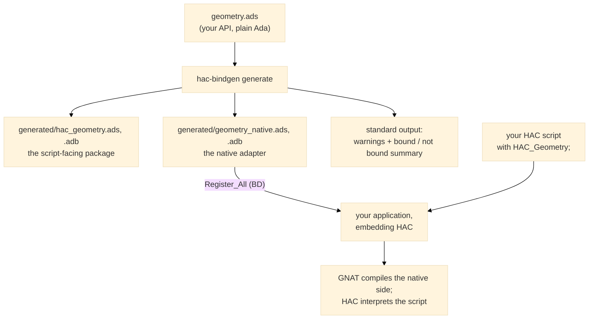

# User guide <!-- omit from toc -->

How to use `hac-bindgen` in your project, and what it does to your
API. The error codes the tool emits have their own index: the
[HACBxxxx catalogue](features/B001_non_bindable_constructs.md#the-catalogue).

## Getting it done

For a package specification `geometry.ads`, one command generates the
facade:

```sh
hac-bindgen generate geometry.ads --output-dir generated --hac-package HAC_Geometry
```

What hac-bindgen writes, and what everyone does with it:



| Step | Who | What |
|---|---|---|
| 1. Generate | you | `hac-bindgen generate SOURCE... [--output-dir DIR] [--hac-package NAME]` |
| 2. Compile | GNAT | the generated `*_native.ads/.adb` (and the API body) join your GNAT project; call `<Pkg>_Native.Register_All (BD)` from your embedding main — see the complete example in [tests/e2e/witness_main.adb](../tests/e2e/witness_main.adb) |
| 3. Run | HAC | your script `with`s the HAC-side package and calls the bound operations like any Ada package |

The generated file set, for a package `Geometry`:

| File | Side | Content |
|---|---|---|
| `geometry.ads` / `.adb` (or `hac_geometry.ads` / `.adb` with `--hac-package`) | HAC | the package the script `with`es: bound declarations, type mirrors, private imports |
| `geometry_native.ads` / `.adb` | native | `Register_All (BD)`, one callback per bound operation, the conversions, the handle registries |

`--hac-package` renames the HAC-side package so the generated files
can live in your source tree without clashing with the real
`geometry.ads` in GNAT's path. `hac-bindgen check SOURCE...` runs the
analysis and the classification only — same warnings, same summary,
no files written.

## What hac-bindgen does to your API

The analysis pipeline is: **analyze** (Libadalang backend, isolated in
its own crate) → **classify** (bindable or not) → **generate**. One
traversal feeds both `check` and `generate` ([S006]).

Bound today — the scalar, string, handle and record profiles
([A002](features/A002_facade_generation.md),
[A004](features/A004_handles.md),
[A005](features/A005_enumerations.md),
[A006](features/A006_strings.md),
[A009](features/A009_records.md)):

- Procedures and functions with `in` parameters; a bound function is
  a real HAC function for the script.
- `out` and `in out` parameters of procedures: scalars, strings and
  records are written back into the script's variables, and the
  native range checks apply on the way back too.
- Scalars: `Integer`, `Long_Float`, `Boolean`, user-defined range
  types and their subtypes, and
  enumerations — mirrored exactly on the HAC side and converted by
  position, so representation clauses are harmless.
- Strings: a `String` parameter or function result crosses as the
  HAC `VString`, owned by copy on both sides; a constrained string
  subtype warns out ([HACB0018]).
- Records: a record with a flat list of bindable components —
  scalars, strings, nested records — is mirrored HAC-side and
  marshalled component-wise, in declaration order; a variant part or
  an array, access or task component warns out ([HACB0005]).
- Private and tagged private types: bound as **integer handles** —
  the script holds an opaque number, the generated adapter resolves
  it to the object it owns. A generated `Drop_<T>` operation releases
  the registry entry; a dropped or never-issued handle stops the
  script with a defined boundary error.

On one `geometry.ads`, that reads:

```ada
package Geometry is

   --  Bound: records cross component by component ([A009]).
   type Point is record
      X, Y : Long_Float;
   end record;

   --  Bound as an integer handle: the script holds an opaque
   --  number, the adapter owns the object ([A004]).
   type Scene is private;

   --  Bound: the record copies back into the script's variable.
   procedure Translate (P : in out Point; Dx, Dy : in Long_Float);

   --  Bound: a scalar result is a real HAC function result.
   function Distance (A, B : Point) return Long_Float;

   --  Bound: the script passes a VString, owned by copy ([A006]).
   procedure Set_Name (S : in Scene; N : in String);

   --  Warned out [HACB0005]: HAC function results are atomic types
   --  only. Declare a procedure with an out parameter instead.
   function Midpoint (A, B : Point) return Point;

   --  Warned out [HACB0005]: arrays have no boundary mapping yet.
   type Grid is array (1 .. 100) of Long_Float;

   --  Warned out [HACB0017]: character-literal enumerations.
   type Option is ('a', 'b');

end Geometry;
```

Warned out, never silently dropped ([B001]): each non-bindable
declaration gets a stable `HACBxxxx` identifier, the source location,
and a reason, on standard output, followed by a per-package bound /
not bound summary. Warnings are diagnostics: the exit status stays
`0`. The full catalogue — what each code means and why — is the
[HACBxxxx index](features/B001_non_bindable_constructs.md#the-catalogue).

Not yet (planned, [docs/roadmap.md](roadmap.md)): arrays as boundary
values, fixed-point and modular types, and a facade generated
straight from the kernel API (the script-facing reshaping — functions
turned into `out` procedures, literal renaming — is on the user
today).

The conversion rule everywhere: **no silent conversion** ([S003]) —
a value that cannot cross safely is warned out at generation time or
reports a defined error at run time, never a default value.
